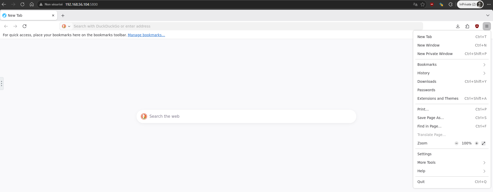
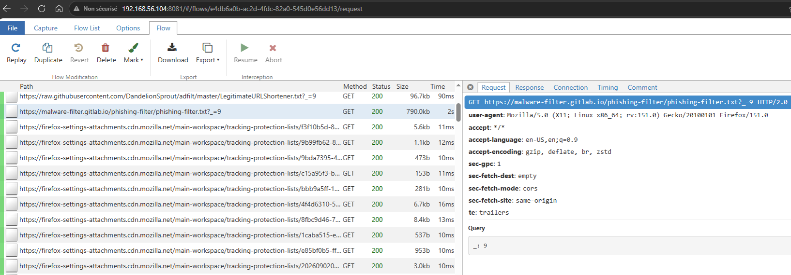

bibsnoop - Browser-in-Browser traffic snooping with mitmproxy
=============================================================

Description
-----------
Docker images for *Browser-in-Browser* with traffic observable via `mitmproxy`, allowing different kind of tasks such as phishing / web threats analysis.  

Features
--------
* Based on the ["baseimage-gui" docker image](https://github.com/jlesage/docker-baseimage-gui) of [@jlesage](https://github.com/jlesage/) providing the [stack foundations](https://github.com/jlesage/docker-baseimage-gui#content): OS, window manager, X server, Web server and [noVNC](https://novnc.com)
* Docker images are currently built for x64 and arm64
* LibreWolf is currently used as the browser but other browsers are planned
* No builtin generic CA certificates: the MiTM CA used between the browser and `mitmproxy` is randomly dynamically generated at each start of the Docker image
* Can route egress traffic through TOR, and choose TOR ExitNodes

Quickstart
-----
```
docker run --rm -it \
  -p 5800:5800 \
  -p 8081:8081 \
  ghcr.io/maaaaz/bibsnoop-librewolf:latest
```

Usage
-----
* Port **5800** is the **noVNC WebUI of the Browser-in-Browser**


* Port **8081** is the **mitmproxy WebUI**


Options
-------
Two sort of options can be cumulatively passed:
* The ones provided by **"baseimage-gui" docker image** such as app user permissions, enabling audio from the web browser, clipboard etc.
  - See the ["public environment variables" section](https://github.com/jlesage/docker-baseimage-gui#public-environment-variables)
    
* The ones provided **specifically** for `bibsnoop`:
  - `TOR_EGRESS`: route egress traffic through TOR (browser -> mitmproxy -> TOR)  
    ```
    docker run --rm -it \
      -p 5800:5800 \
      -p 8081:8081 \
      -e "TOR_EGRESS=1" \
      ghcr.io/maaaaz/bibsnoop-librewolf:latest
    ```
  - `TOR_EGRESS_EXITNODES`: route egress traffic through chosen TOR exit node countries
    ```
    docker run --rm -it \
      -p 5800:5800 \
      -p 8081:8081 \
      -e "TOR_EGRESS=1" \
      -e "TOR_EGRESS_EXITNODES={fr},{nl}"
      ghcr.io/maaaaz/bibsnoop-librewolf:latest
    ```

Remarks
-------
If you serve access to `mitmproxy` port through a reverse-proxy, be sure that the `Origin` header is set to the correct local address+port.  
For instance, if you do this port mapping through Docker `-p 127.0.0.1:8081:8081`, and you want to do a path-based reverse-proxying with `Nginx`, you need a config similar to this:
```
map $http_upgrade $connection_upgrade {
    default upgrade;
    ''      close;
}

location = /mitm {
    return 301 /mitm/;
}

location /mitm/ {
    proxy_pass http://127.0.0.1:8081/;

    proxy_http_version 1.1;
    proxy_set_header Upgrade $http_upgrade;
    proxy_set_header Connection $connection_upgrade;

    proxy_set_header Host 127.0.0.1:8081;
    proxy_set_header Origin http://127.0.0.1:8081;

    proxy_set_header X-Real-IP $remote_addr;
    proxy_set_header X-Forwarded-For $proxy_add_x_forwarded_for;
    proxy_set_header X-Forwarded-Proto $scheme;

    proxy_buffering off;
    proxy_read_timeout 86400s;
    proxy_send_timeout 86400s;
}
```
More info [here](https://github.com/mitmproxy/mitmproxy/discussions/6960) and [there](https://github.com/mitmproxy/mitmproxy/discussions/7198).  

Copyright and license
---------------------
* All trademarks, service marks, trade names and product names appearing on this repository are the property of their respective owners 
* Content provided in this repository is distributed with the MIT licence

Inspiration and useful resources
----------------
* https://jlesage.github.io/docker-apps/ + https://github.com/jlesage?tab=repositories
* https://github.com/tbetous/mitm-chrome/
* https://github.com/m1k1o/neko
